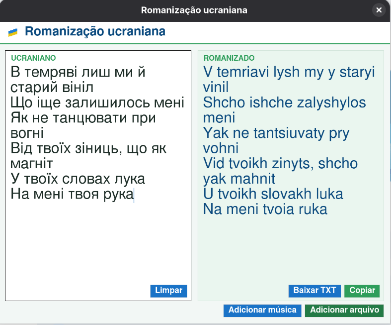

# Romanizador ucraniano



Aplicativo de desktop que converte texto em ucraniano para o alfabeto latino (romanização). Também transcreve áudios e vídeos em ucraniano e romaniza o resultado.

## Sobre o projeto

O app surgiu da dificuldade de ler rapidamente textos em alfabeto cirílico no nível iniciante. Também se mostrou útil para acompanhar músicas, já que a letra romanizada permite seguir o texto sem precisar decifrar o cirílico.

### Funcionalidades

- Romanização automática conforme o texto é digitado ou colado.
- Tratamento de posição para as letras є, ї, ю e я, que mudam de som conforme a letra anterior, e para й, que muda conforme a vogal que vem antes.
- Leitura de arquivos `.txt`, `.md`, `.csv`, `.pdf` e `.docx`, cujo conteúdo é inserido na área de entrada.
- Transcrição de áudio e vídeo (`.mp3`, `.wav`, `.ogg`, `.flac`, `.m4a`, `.aac`, `.opus`, `.mp4`, `.mkv`, `.webm`) com o modelo Whisper `small`, executado em CPU.
- Cópia do resultado para a área de transferência ou exportação em `.txt`.

> A romanização usa um esquema próprio e simplificado. Ela não corresponde a um padrão oficial de transliteração.

## Requisitos

- Python 3
- tkinter (já incluído na maioria das instalações do Python; no Linux, pode ser preciso instalar `python3-tk`)
- Dependências de terceiros:

```bash
pip install faster-whisper pypdf python-docx
```

`faster-whisper` é necessário apenas para áudio e vídeo, `pypdf` para PDF e `python-docx` para DOCX. Na primeira transcrição, o modelo Whisper é baixado automaticamente.

## Como compilar

O projeto é escrito em Python, que é interpretado, então não há etapa de compilação. Para executar, rode a partir da pasta do projeto:

```bash
python main.py
```

## Estrutura do projeto

```
Romanizador/
├── main.py            # ponto de entrada: cria a janela
├── interface.py       # interface gráfica (tkinter)
├── romanizacao.py     # romanização, leitura de documentos e transcrição
├── icone.png          # ícone da janela
├── captura_tela.png   # captura de tela usada neste README
└── .vscode/
    └── settings.json  # configuração do editor
```
# Romanizador-ucraniano
